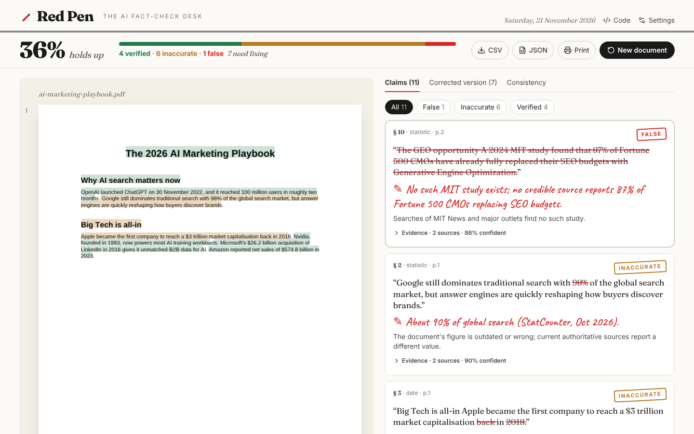
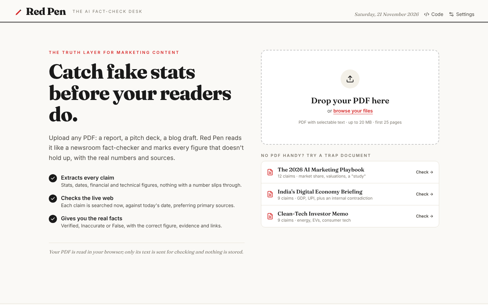
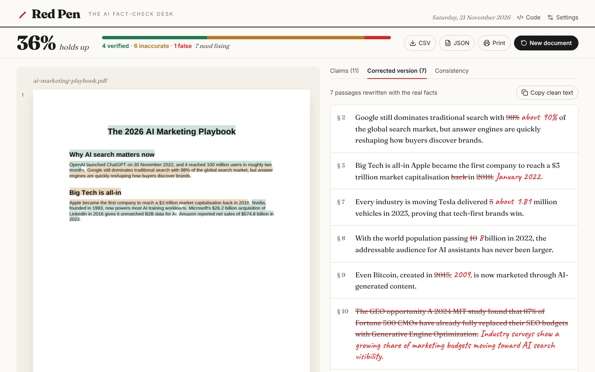

# ✎ Red Pen: an AI fact-check desk for marketing PDFs

> **Upload a PDF. Red Pen extracts every stat, date and figure, checks each one against the live web, and marks what's wrong, with the real facts, evidence and sources.**

**Live app:** `<add Vercel URL>` · **Demo video (30 s):** `<add link>`



---

## The problem

Marketing content is full of numbers that *sound* authoritative but are outdated ("Google has 98% of search"), inflated ("Tesla delivered 5 million cars in 2023") or invented ("a 2024 MIT study found…"). Red Pen is a **truth layer**: it reads a document the way a newsroom fact-checker would and flags every claim that doesn't hold up **before** it is published.

Every claim gets one of three verdicts:

| Verdict | Meaning |
|---|---|
| ✓ **Verified** | Matches current, reliable data |
| ≠ **Inaccurate** | Real topic, but the figure is wrong, exaggerated or **outdated**. Red Pen gives the correct, latest figure |
| ✗ **False** | No credible evidence: a fabricated statistic, a non-existent study, an invented event |

## What it does

- **Extracts** every checkable claim (statistics, dates, financial and technical figures, named-entity facts), rewritten as a self-contained sentence with the verbatim quote and page.
- **Verifies** each claim against the **live web** (OpenAI Responses API + `web_search` tool), date-aware, preferring primary sources.
- **Reports** the verdict, the **real fact**, a short explanation, an **evidence quote** from the source, links and a confidence score.
- **Highlights the claims inside the PDF**, coloured by verdict. Click a highlight to jump to its card, and vice versa.
- **Writes a corrected version** of every flagged passage, shown as editor's proof marks (~~wrong~~ ✎ right), with "copy clean text".
- **Checks internal consistency**: flags places where the document contradicts itself.
- **Trust score**: the share of checked claims that hold up.
- **Exports** CSV, JSON or a printable report.
- **Reviewer-proof**: three built-in trap documents, bring-your-own-key if the hosted credits run out, clear error messages.

<p>
  
  
</p>

## How the verification works (and why it catches trap documents)

```
PDF ─► pdf.js (in the browser): render pages + extract positioned text
    ─► POST /api/extract
         1. LLM extracts self-contained claims (+ verbatim quote, page, search query)
         2. Recall guard: regex finds EVERY sentence containing a number, %, currency
            or year; any sentence whose figures no claim covers is re-extracted.
            → a planted lie can't slip through extraction.
    ─► POST /api/verify   (one request per claim, 4 in parallel, live progress)
         • today's date is in the prompt → old stats presented as current = Inaccurate
         • ≥ 2 web searches: the claim itself + "latest <topic> <year>"
         • source priority: official/primary → statistics agencies → reputable news
         • returns verdict, correct fact (with as-of date), evidence quote, sources
         • confidence < 70 → automatic second opinion with different queries,
           then reconciled (agreement raises confidence; a tie keeps the flag,
           because missing a planted error is worse than a false alarm)
    ─► POST /api/consistency  internal contradictions across the document's claims
    ─► POST /api/correct      rewrites each flagged passage with the real facts
```

Design choices worth noting:

| Decision | Why |
|---|---|
| The browser orchestrates short requests (one per claim) instead of one long job | Stays well inside serverless time limits, and the user watches verdicts land live |
| PDF parsed client-side with pdf.js | No upload-size limits on the server, and the same text positions power the highlights |
| Recall guard on top of LLM extraction | LLMs sometimes skip "boring" figures; traps hide exactly there |
| Evidence quote + sources per verdict | A fact-check you can't audit isn't a fact-check |
| Failure isolation | One failed claim shows "Not checked"; the rest of the report still completes |

## Tech stack

- **Frontend:** React 19, TypeScript, Vite, Tailwind CSS 4, pdf.js, lucide icons
- **Backend:** Python FastAPI, served as a single Vercel Python function (`api/index.py`)
- **AI:** OpenAI Responses API with the built-in `web_search` tool (default model `gpt-4.1-mini`)
- **Hosting:** Vercel (static frontend + Python serverless function)

## Project structure

```
api/index.py              FastAPI routes: /api/health, extract, verify, consistency, correct
factcheck/                Python package (all fact-checking logic)
  claims.py               claim extraction + numeric-sentence recall guard
  verifier.py             live-web verification, second opinion, reconcile()
  review.py               internal contradictions + corrected passages
  llm.py                  OpenAI Responses API wrapper, JSON parsing, citations
  models.py               pydantic models (Claim, ClaimResult, Verdict…)
src/                      React app
  hooks/useFactCheck.ts   workflow state machine (read → extract → verify → review)
  lib/pdf.ts              pdf.js rendering + positioned text
  lib/highlight.ts        maps claim quotes to highlight rectangles
  lib/diff.ts             word diff for proof marks
  components/             UploadScreen, SummaryBar, PdfViewer, ClaimCard, ReviewTabs…
public/samples/           three trap PDFs used by the "Try a trap document" buttons
samples/make_trap_pdfs.py generates the trap PDFs + their answer keys
tests/                    pytest suite (LLM faked, no API key needed)
requirements.txt          Python dependencies
```

## Run locally

Prerequisites: Python 3.10+, Node 20+, an OpenAI API key.

```bash
pip install -r requirements-dev.txt
npm install
export OPENAI_API_KEY=sk-...
```

Terminal 1, API on :8000:
```bash
npm run api
```

Terminal 2, app on http://localhost:5173 (proxies `/api` to :8000):
```bash
npm run dev
```

Tests (no API key needed):
```bash
pytest -q
npm run lint
```

## Deploy to Vercel

1. Push this repository to GitHub.
2. In Vercel: **Add New → Project → Import** the repo (framework preset *Vite* is detected; `vercel.json` configures the Python function).
3. **Settings → Environment Variables:** add `OPENAI_API_KEY` (optional: `OPENAI_MODEL`).
4. Deploy. The app is served at `/` and the API at `/api/*`.

## Configuration

| Variable | Required | Default | Notes |
|---|---|---|---|
| `OPENAI_API_KEY` | ✅ | | Server key used for all checks |
| `OPENAI_MODEL` | | `gpt-4.1-mini` | Any Responses-API model that supports `web_search` |

Reviewers can also paste their own key in **Settings**; it is held in the tab's memory only and sent with their requests.

## Test documents (answer keys)

Three trap PDFs ship with the app (`public/samples/`, answer keys in `samples/make_trap_pdfs.py`). Examples:

| Document says | Expected | Real fact |
|---|---|---|
| Google holds 98% of global search | ≠ Inaccurate | ~90% (StatCounter) |
| Apple first hit a $3T market cap in 2018 | ≠ Inaccurate | $1T in 2018; $3T in Jan 2022 |
| Tesla delivered 5 million vehicles in 2023 | ≠ Inaccurate | ~1.81 million |
| A 2024 MIT study: 87% of CMOs replaced SEO with GEO | ✗ False | No such study |
| UPI processes ~1 million transactions a month | ≠ Inaccurate | ~20 billion a month |
| "UPI launched in 2016" vs "since UPI's launch in 2019" | Contradiction | 2016 |
| Solar supplies 40% of the world's electricity | ≠ Inaccurate | ~7% (2024) |
| A Stanford study: EV batteries last 300 years | ✗ False | No such study |
| ChatGPT launched 30 Nov 2022 | ✓ Verified | |

## Limitations

- Scanned / image-only PDFs are not supported (no OCR yet).
- Up to 25 pages and 40 claims per document, to keep cost and latency bounded.
- Verdicts depend on what is findable on the open web; paywalled data may come back as "False (no evidence)".
- LLM judgements can still be wrong: the evidence quote and sources are there so a human can confirm.

## Roadmap

OCR for scanned PDFs · URL and Google Docs input · shareable report links · a browser extension to fact-check while writing · a team workspace with a "fact sheet" of approved company figures.
